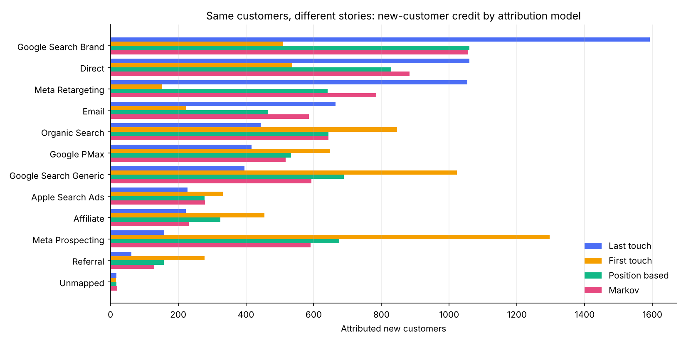
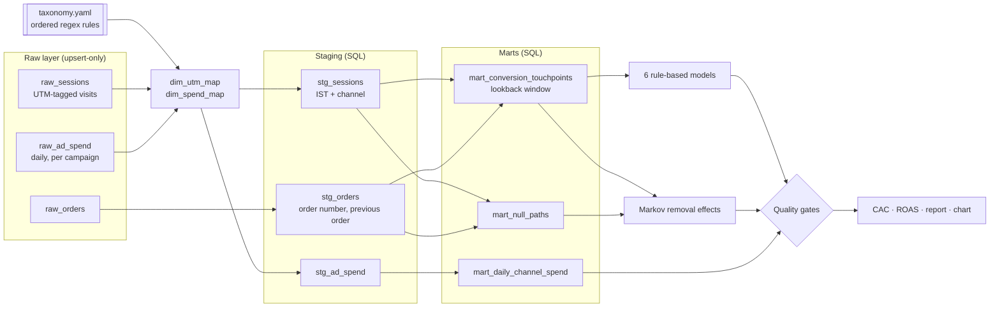

# Marketing Attribution Pipeline

**Which channel actually earned the customer?** This project answers that question end to end. It ingests messy marketing data, resolves every campaign to a channel, builds customer journeys, runs seven attribution models side by side, and reports CAC and ROAS per channel, all behind data-quality gates.

It runs on **fully synthetic data** for *Brewline*, a fictional D2C coffee brand in India. The data has the same kinds of mess you see in real ad-platform and analytics exports.

```bash
pip install -r requirements.txt
python -m mta run          # ~6 seconds: generate → load → stage → attribute → check → report
```



## Why it matters

Last-click attribution is still the default in most ad dashboards, and it systematically misleads budget decisions. In the sample run (seed 42, 50,000 simulated users, 60 days):

| Channel | Last-touch CAC | Markov CAC | What last-click tells you |
|---|---:|---:|---|
| Meta Prospecting | ₹1,947 | ₹524 | "Cut it." Yet it opens more journeys than any other channel |
| Google Search Generic | ₹1,443 | ₹963 | "Barely profitable" |
| Google Search Brand | ₹158 | ₹238 | "Our best channel." It mostly closes journeys others started |
| Meta Retargeting | ₹225 | ₹302 | "Scale it." It depends on prospecting to fill the pool |

The full output, including all seven models, ROAS tables and quality checks, is in [`docs/sample_output/report.md`](docs/sample_output/report.md).

## How it works



1. **Generate** (`mta/generate.py`): simulates user journeys across 11 channels, with first orders and repeat orders, then derives daily campaign spend from paid clicks. The mess is deliberate:
   - inconsistent UTM case and whitespace, plus hyphens versus underscores
   - a campaign renamed mid-period
   - ad-spend rows re-pulled with restated numbers
   - a stray test campaign
   - timestamps in UTC
2. **Load** (`mta/etl.py`): every raw file is upserted on its natural key (`INSERT … ON CONFLICT DO UPDATE`). Re-running a load never duplicates rows, and when a row is restated the latest value wins. Nothing in the raw layer is deleted.
3. **Resolve channels** (`config/taxonomy.yaml`, `mta/taxonomy.py`): ordered regex rules map normalised source, medium and campaign values to a channel. Adding a new campaign convention means editing YAML, not code.
4. **Stage and build marts** (`sql/`): plain SQL with window functions:
   - IST conversion
   - order numbering and the previous order
   - conversion paths limited to a 30-day lookback window, with touches before the customer's previous order excluded
   - non-converting paths for the Markov model
5. **Attribute** (`mta/models.py`, `mta/markov.py`): runs the seven models below.
6. **Check** (`mta/quality.py`): runs the gates listed further down. Any FAIL stops the run with a non-zero exit code.
7. **Report** (`mta/reports.py`): writes channel CAC and ROAS per model, a daily blended view, a chart, and a Markdown report whose findings are computed from the results, not written by hand.

## Attribution models

| Model | Rule | Good for |
|---|---|---|
| First touch | 100% to the first touch | Understanding what *starts* journeys |
| Last touch | 100% to the last touch | Matching what ad platforms report |
| Last non-direct | 100% to the last non-Direct touch | The common GA-style default |
| Linear | Equal split | A simple multi-touch baseline |
| Time decay | Weight halves every 7 days before the order | Short consideration cycles |
| Position based | 40% first / 40% last / 20% middle | Valuing both opening and closing |
| **Markov** | Removal effect on a first-order Markov chain, using non-converting paths too | Data-driven credit without hand-picked weights |

For the Markov model: a channel's credit is how much the overall conversion probability falls when that channel is removed from the transition graph. Shares for new customers are estimated from first-order journeys only.

## Data-quality gates

| Check | Why |
|---|---|
| One row per key after load | Proves the upserts collapse re-pulled rows |
| Every order has a conversion path | No conversions silently dropped |
| Spend reconciles from raw to mart | No spend lost or double counted in joins |
| No unmapped spend (FAIL) / sessions (WARN) | Taxonomy gaps show up instead of hiding in "Other" |
| Credits sum to 1 per conversion | Each rule-based model is internally consistent |
| Every model reconciles to total orders and revenue | Models redistribute credit; they never invent or lose it |
| Session dates converted to IST | Reporting dates match the business day |

The sample run deliberately keeps one **WARN**: a `test_campaign_do_not_use` UTM that no rule maps, which is exactly what the check should catch.

## Design decisions

- **Idempotent by construction.** The raw layer is upsert-only on natural keys, and derived layers are rebuilt deterministically, so a rerun is always safe.
- **The taxonomy is configuration.** Campaign naming changes all the time, so the rules live in YAML with tests, not in `if` statements.
- **SQL for set logic, Python for models.** Joins, windows and lookback filters are plain SQL you can read; the attribution maths is vectorised pandas and NumPy.
- **Report in the business timezone.** Raw timestamps stay in UTC and every reporting date is IST.
- **Zero infrastructure.** SQLite from the standard library keeps it runnable anywhere. The SQL ports directly to BigQuery or MySQL 8.

## Project layout

```
config/taxonomy.yaml     channel rules
mta/generate.py          synthetic data
mta/etl.py               upsert loader + channel maps + SQL runner
mta/models.py            rule-based models
mta/markov.py            Markov removal-effect model
mta/quality.py           data-quality gates
mta/reports.py           CAC / ROAS tables, chart, Markdown report
mta/pipeline.py          orchestration
sql/                     schema, staging, marts
tests/                   50 tests: models, Markov, taxonomy, end-to-end idempotency
docs/sample_output/      results of the seed-42 run
```

## Options

```bash
python -m mta run --regenerate --users 100000 --days 90 --seed 7
python -m mta run --lookback-days 14 --half-life-days 3
pytest
```

## Possible extensions

- Shapley-value attribution and a comparison with Markov
- Incrementality calibration using geo holdouts
- Moving the warehouse to BigQuery and scheduling it on Cloud Run
- A small dashboard on top of `output/channel_performance.csv`

---

All data in this repository is synthetic. *Brewline* is fictional, and no real company's data, names or figures are used.

Built by **Nihal Khan**: [GitHub](https://github.com/nihallkhann7-creator) · nihallkhann7@gmail.com
